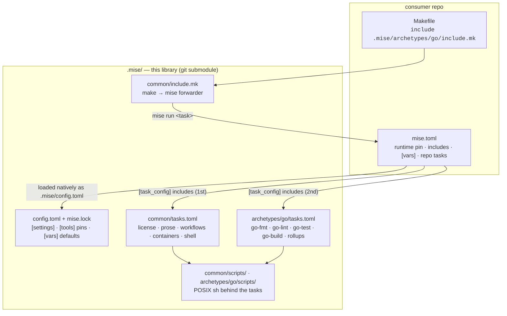

# Architecture

The toolchain is a set of layered mise config and task files. The library supplies tools and tasks, the repo picks and
configures them, and a thin make shim forwards everything to mise.

## The layers



| Layer           | File                                  | Holds                                                      |
| --------------- | ------------------------------------- | ---------------------------------------------------------- |
| Make shim       | `common/include.mk` + archetype shims | Forwards every make target to `mise run`. No logic.        |
| Shared config   | `config.toml`                         | `[settings]`, the `[tools]` pins, `[vars]` knob defaults.  |
| Lockfile        | `mise.lock`                           | Per-platform sha256 and provenance for every shared pin.   |
| Common tasks    | `common/tasks.toml`                   | Tasks every repo gets, plus rollups for common-only repos. |
| Archetype tasks | `archetypes/<lang>/tasks.toml`        | Language passes plus the `fmt`/`lint`/`ci`/`pr` rollups.   |
| Scripts         | `common/scripts/`, `…/scripts/`       | The POSIX shell behind anything longer than a one-liner.   |
| House config    | `.prettierrc.yaml` and friends        | Prose defaults read from `.mise/` by every consumer.       |

## How mise assembles a repo's config

mise reads config from several places and merges them, with the repo's root file taking precedence:

1. **`.mise/config.toml`**: the library's shared config. mise loads any `.mise/config.toml` automatically, which is why
   the submodule is mounted at exactly that path. It contributes `[settings]` (lockfile on, a 3-day minimum release
   age), the shared `[tools]` pins and the `[vars]` defaults.
2. **`mise.toml`**: the repo's root config. It wins on any collision: a `[tools]` entry here overrides the shared pin,
   and a `[vars]` entry overrides the default.

Tasks come from `[task_config] includes` in the root `mise.toml`. Included task files use mise's simplified format,
where each top-level key is a task name, and they can't include other files themselves. That's why the consumer lists
both files explicitly:

```toml
[task_config]
includes = [".mise/common/tasks.toml", ".mise/archetypes/go/tasks.toml"]
```

!!! note "Why `config.toml` never contains `[task_config]`"

    Include paths resolve against the consumer's repo root. If the library's own `config.toml` listed includes, the
    paths would break in every consumer. Archetype selection always lives in the consumer's root `mise.toml`.

## Task merging

mise merges task files **whole-task**, and the later include wins. This one rule drives most of the design:

- `common/tasks.toml` defines `fmt`, `lint`, `ci` and `pr` rollups for a repo with nothing to compile.
- An archetype redefines those same rollups with its language passes added. Because it's included second, its versions
  replace common's.
- Two archetypes can never coexist: the second would replace the first's rollups.
- A repo can redefine any task by including its own task file after the archetype. See
  [Extending & overriding](extending.md).

## Leaf tasks and rollups

Tasks come in two kinds.

**Leaf tasks** do one job, such as `go-lint`, `lint-prose` or `license-check`. Helpers that only exist to be wired into
rollups are `hide = true`, so they stay out of `make help`. Anything longer than a one-liner calls a script in
`scripts/`, and structural knobs reach the script as environment variables set on the task:

```toml
[go-lint]
hide = true
dir = "{{cwd}}"
env = { TOOLCHAIN_GOOS = "{{vars.goos}}" }
run = "{{config_root}}/.mise/archetypes/go/scripts/lint.sh"
```

**Rollups** are sequential composites of leaf tasks:

```toml
[pr]
description = "full local gate before a pull request"
run = [
  { task = "tidy" },
  { task = "fmt" },
  { task = "lint" },
  { task = "test" },
  { task = "build" },
  { task = "commit" },
]
```

Running the steps in sequence means the mutating passes never race, and `fmt` always finishes before `lint` starts.

### Where tasks run

Leaf tasks run in one of two directories:

- **`{{cwd}}`**, the invoking directory, for anything that targets "the module here". This lets the terraform archetype
  run `plan` in `environments/prod/`, and lets a Go repo build from wherever make was called.
- **`{{config_root}}`**, the repo root, for repo-wide sweeps: prose, workflows, containers, shell. Running `make lint`
  in a Terraform environment subdirectory still lints every Markdown file in the repo.

## The make shim

`common/include.mk` is the whole make surface. It:

- declares the well-known task names `.PHONY` and forwards each to `mise run $@`, so a `docs/` or `coverage/` directory
  can never shadow a target with "is up to date";
- forwards **any other** target through a `.DEFAULT` catch-all, so repo-local tasks work as `make <task>` without
  editing the Makefile;
- sets `.NOTPARALLEL`, so `make fmt lint` keeps its command-line order and two mise processes never race a first-time
  tool install;
- makes `help` (`mise tasks`) the default goal, and fails with an install hint if mise isn't on `PATH`.

Each archetype's `include.mk` adds its extra task names to `MISE_TASKS` (the go shim adds
`tidy snapshot release fuzz docs-build sync`), then includes the common forwarder.

## Pinned tools on PATH

Every task runs with the pinned tools already on `PATH`. mise resolves each `[tools]` entry against `mise.lock`,
installs it into its shared per-machine store on first use, and verifies the checksum. There's no tool-path plumbing:
scripts just call `golangci-lint`, `prettier` or `grype`. See [Pinned tools](tools.md).

## This repository's own layout

This repo dogfoods its own tasks, but its layout is **inverted**. In a consumer, the library sits at `.mise/`. Here,
`config.toml`, `common/` and `archetypes/` sit at the repo root, because this repo _is_ the library. To make the paths
match, `.mise/` here holds symlinks back to the root entries:

```text
.mise/
├── archetypes -> ../archetypes
├── common     -> ../common
├── config.toml -> ../config.toml
└── mise.lock  -> ../mise.lock
```

The root `mise.toml` includes `common/tasks.toml` and `archetypes/python/tasks.toml` (it builds this docs site), and the
`{{config_root}}/.mise/…` paths inside the tasks resolve through the symlinks exactly as they would in a consumer. See
[Working on the toolchain](../reference/contributing.md).
