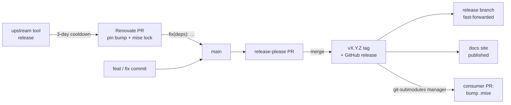

# Releases & updates

A change to the toolchain reaches the fleet in three hops: a commit here, a tagged release, and a submodule bump in each
consumer. Most of it is automated.



## Bumping a shared tool

The org Renovate bot ([`renovate-config`](https://github.com/bitwise-media-group/renovate-config)) keeps the pins
current:

- Every `[tools]` entry in `config.toml` is an exact pin. The bot opens **one pull request per tool** that bumps the pin
  **and** regenerates `mise.lock` (`mise lock`) in the same commit, so the checksums always match.
- A release must be at least **three days old** before the bot proposes it (`minimumReleaseAge`, surfaced as the
  `renovate/stability-days` check).
- **Stable minor and patch bumps automerge** once green. Majors and 0.x versions wait for review.

This repo's `.github/renovate.json5` adds two things the org preset can't know:

- **It teaches the mise manager about the root `config.toml`.** The inverted layout hides it from the manager's default
  file patterns, which only match `mise.toml` and `*/mise/config.toml`.
- **It lands tool bumps as `fix(deps):`**, so release-please cuts a patch release and consumers get the new pin. Bumps
  to this repo's own workflow callers land as `ci:`, which release-please ignores, because they're CI plumbing rather
  than library content.

### Bumping by hand

Edit the pin in `config.toml` and re-lock:

```sh
GITHUB_TOKEN="$(gh auth token)" mise lock
```

Set `GITHUB_TOKEN` first. Unauthenticated GitHub API calls can hit rate limits and silently drop lockfile entries.

## Cutting a release

Releases are driven by [Conventional Commits](https://www.conventionalcommits.org/) and release-please, through the
reusable release workflow:

1. **release-please keeps a release PR current** on `main`, deriving the next version and changelog from the commit
   history. `feat:` bumps the minor version, `fix:` the patch, and `feat!:` or a `BREAKING CHANGE:` footer the major.
2. **Merging that PR cuts the `vX.Y.Z` tag** and the GitHub release. The PR is authored by the FF Merge GitHub App
   rather than `GITHUB_TOKEN`, so it can auto-merge like any other PR once approved and green.
3. **The `release` branch is fast-forwarded** to the tagged commit. The push is deliberately non-force: if `release`
   ever diverged from the tagged history, the push fails loudly instead of rewriting what consumers have pinned.
4. **The docs job publishes this site** to GitHub Pages, because a `zensical.toml` sits at the repo root.

The library ships no binaries, so the workflow's GoReleaser job is skipped.

## Reaching the consumers

Each consumer mounts the library as a submodule at `.mise/`. Renovate's **`git-submodules` manager** watches the semver
tags and opens a pull request bumping `.mise` to each new release. Once that PR merges, CI checks out the new submodule
commit, and developers pick it up with `git submodule update --init`. mise installs any changed tool on first use.

So bumping a shared tool for the **whole fleet** is one commit here plus one automated PR per consumer.

!!! danger "Never re-lock in a consumer"

    `mise.lock` for the shared pins lives in this library. Running `mise lock` or `mise upgrade` in a consumer writes
    into the submodule's working tree. Change shared pins here, and let the submodule bump carry them.

## Versioning policy

Treat a change by its effect on consumers:

| Change                                                                | Commit type |
| --------------------------------------------------------------------- | ----------- |
| A tool pin bump                                                       | `fix(deps)` |
| A bug fix in a task or script                                         | `fix`       |
| A new task, knob, archetype capability or tool                        | `feat`      |
| Renaming or removing a task or knob, or changing the include contract | `feat!`     |
| This repo's own CI callers                                            | `ci`        |
| Docs-only changes                                                     | `docs`      |

The v2 to v3 move (`tasks/<archetype>.toml` plus `mise.mk` replaced by `common/` plus `archetypes/`) is an example of a
breaking change. See [Migrating from v2](../reference/migrating.md).
